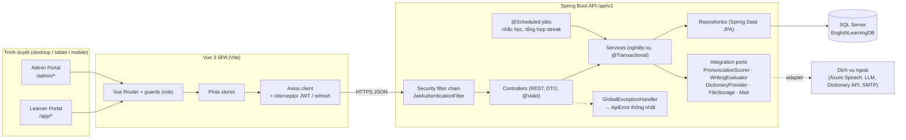

# EnglishHub – Giai đoạn 1: Kiến trúc tổng thể

## 1. Quyết định công nghệ

| Hạng mục | Lựa chọn | Ghi chú |
|---|---|---|
| Backend | Java 17+ (chạy tốt trên JDK 21), Spring Boot 3.3.x, Maven Wrapper | Web, Data JPA, Security, Validation, Flyway |
| Xác thực | JWT access token (15 phút) + refresh token (7 ngày, lưu **hash** trong DB) | Đăng xuất = thu hồi refresh token |
| Database | SQL Server Express, DB `EnglishLearningDB` | Driver `mssql-jdbc`, Flyway `flyway-sqlserver` |
| Migration | Flyway (`V1__init_schema.sql`, `V2__seed_data.sql`) + `database/00_create_database.sql` chạy tay 1 lần | JPA `ddl-auto: validate` – không để Hibernate tự sửa schema |
| Frontend | Vue 3 + Vite + Vue Router + Pinia + Axios + **Element Plus** + ECharts | Layout responsive bằng CSS grid/breakpoint riêng |
| AI chấm Speaking/Writing | Interface `PronunciationScorer`, `WritingEvaluator` + bản **Mock** | Thêm adapter Azure Speech / LLM sau mà không sửa nghiệp vụ |
| Từ điển | Interface `DictionaryProvider` (mặc định: Free Dictionary API) + cache vào bảng `Words` | |
| Lưu file audio | Interface `FileStorageService` (mặc định: thư mục local `uploads/`) | Có thể đổi sang S3/Azure Blob |

## 2. Sơ đồ kiến trúc



### Luồng xác thực
1. `POST /api/v1/auth/login` → trả `accessToken` (JWT, chứa `sub`=userId, `roles`) + `refreshToken` (chuỗi ngẫu nhiên; DB chỉ lưu SHA-256 hash).
2. Axios gắn `Authorization: Bearer <accessToken>`; khi nhận 401 `TOKEN_EXPIRED` → gọi `/auth/refresh` một lần (hàng đợi request chờ) rồi gửi lại.
3. `POST /auth/logout` → set `RevokedAt` cho refresh token.
4. Quên mật khẩu: `/auth/forgot-password` tạo token (hash lưu ở `PasswordResetTokens`, hết hạn 30 phút) → email (giai đoạn đầu: log ra console) → `/auth/reset-password`.

### Chuẩn API
- Prefix `/api/v1`; admin dưới `/api/v1/admin/**` (yêu cầu `ROLE_ADMIN`).
- Phân trang: `?page=0&size=20&sort=createdAt,desc` → trả `PageResponse<T> { items, page, size, totalElements, totalPages }`.
- Lỗi thống nhất:
  ```json
  {
    "timestamp": "2026-10-14T08:00:00Z",
    "status": 400,
    "code": "VALIDATION_ERROR",
    "message": "Dữ liệu không hợp lệ",
    "path": "/api/v1/auth/register",
    "errors": [{ "field": "email", "message": "Email không đúng định dạng" }]
  }
  ```

## 3. Các module nghiệp vụ (bounded modules)

| Module | Trách nhiệm | Bảng chính |
|---|---|---|
| `auth` | Đăng ký, đăng nhập, refresh, logout, quên mật khẩu | Users, Roles, UserRoles, RefreshTokens, PasswordResetTokens |
| `user` | Hồ sơ, mục tiêu, cài đặt nhắc học; admin quản lý user | Users |
| `catalog` | Level, chủ đề, khóa học, bài học, phụ đề | Levels, Topics, Courses, Lessons, LessonTranscriptSegments |
| `assessment` | Ngân hàng câu hỏi, bài test (placement/quiz), làm bài, chấm điểm | Questions, QuestionOptions, Tests, TestQuestions, TestAttempts, AttemptAnswers |
| `learningpath` | Sinh & điều chỉnh lộ trình | LearningPaths, LearningPathItems |
| `skill` | Nộp bài Speaking/Writing, gọi AI chấm | SpeakingSubmissions, WritingSubmissions |
| `vocabulary` | Từ điển, bộ từ, sổ từ cá nhân, SRS SM-2 | Words, VocabularySets, VocabularySetWords, UserWords, FlashcardReviews |
| `progress` | Tiến độ bài học, thời gian học, streak, dashboard | LessonProgresses, StudySessions, DailyActivities, UserStreaks |
| `notification` | Thông báo in-app, nhắc học hằng ngày | Notifications |
| `report` | Thống kê cho admin | (đọc tổng hợp từ các bảng trên) |

## 4. Nghiệp vụ phức tạp – thiết kế trước

### 4.1 Placement Test → Level
- Test `TestType = 'PLACEMENT'`, 20 câu trải từ dễ đến khó (Difficulty 1–5), thời gian 20 phút.
- Điểm = tổng `Points` câu đúng / tổng điểm tối đa → `%`.
- Map `%` vào bảng `Levels` qua `PlacementMinPercent`/`PlacementMaxPercent`:

| Level | Code | % |
|---|---|---|
| Mất gốc | `FOUNDATION` | 0 – < 21 |
| Cơ bản | `ELEMENTARY` | 21 – < 46 |
| Trung cấp | `INTERMEDIATE` | 46 – < 71 |
| Nâng cao | `ADVANCED` | 71 – < 86 |
| Luyện thi TOEIC – IELTS | `EXAM_PREP` | 86 – 100 |

Quy tắc chọn: level có `PlacementMinPercent` lớn nhất mà `≤ %` của học viên (tránh lỗ hổng làm tròn giữa các khoảng). Câu khó có trọng số cao hơn (`DefaultPoints` 1 / 1.5 / 2), tổng điểm bài mẫu = 30.

- Lưu `TestAttempts.ResultLevelId`, `SkillScoresJson` (điểm từng kỹ năng – để biết kỹ năng yếu) và cập nhật `Users.CurrentLevelId`.

### 4.2 Sinh lộ trình cá nhân hóa
Input: level hiện tại, `LearningGoal` (GENERAL / COMMUNICATION / TOEIC / IELTS), kỹ năng yếu, `DailyGoalMinutes`.
1. Chọn các khóa học đã publish có `LevelId` = level hiện tại và `GoalType` khớp mục tiêu (ưu tiên) hoặc GENERAL.
2. Lấy bài học theo `SortOrder`, xen kẽ kỹ năng; kỹ năng yếu được đẩy lên trước trong mỗi nhóm.
3. Tạo `LearningPaths` (chỉ 1 path `ACTIVE`/user – filtered unique index) + `LearningPathItems`; item đầu `AVAILABLE`, còn lại `LOCKED`.
4. Người học có thể: thêm/bớt bài (`IsCustom = 1`), bỏ qua (`SKIPPED`), đổi thứ tự, hoặc đổi mục tiêu → path cũ `ARCHIVED`, sinh path mới.

### 4.3 SRS – thuật toán SM-2
Mỗi `UserWords` có `EaseFactor` (mặc định 2.5), `IntervalDays`, `Repetitions`, `DueAt`. Người học tự đánh giá `quality` 0–5:
```
if quality < 3:  repetitions = 0; interval = 1; lapseCount++
else:
    interval = 1 nếu repetitions == 0; 6 nếu repetitions == 1; round(interval * EF) còn lại
    repetitions++
EF = max(1.3, EF + 0.1 - (5 - q) * (0.08 + (5 - q) * 0.02))
DueAt = now + interval ngày
Status: NEW → LEARNING → REVIEW → MASTERED (interval ≥ 21 ngày)
```
Mỗi lần ôn ghi log `FlashcardReviews` (để vẽ biểu đồ & cho phép tinh chỉnh thuật toán sau).

### 4.4 Streak & dashboard
- Mọi hoạt động (học bài, ôn flashcard, làm quiz) cộng dồn vào `DailyActivities` (1 dòng / user / ngày, theo múi giờ user).
- `UserStreaks`: nếu `LastActivityDate` = hôm qua → `CurrentStreak + 1`; = hôm nay → giữ nguyên; khác → reset 1.
- Dashboard đọc trực tiếp `DailyActivities` theo khoảng ngày (index `(UserId, ActivityDate)`), tuần/tháng gộp bằng `GROUP BY`.

### 4.5 Tích hợp AI (Ports & Adapters)
```java
public interface PronunciationScorer {
    PronunciationResult score(byte[] audio, String referenceText, String locale);
}
public interface WritingEvaluator {
    WritingFeedback evaluate(String text, String prompt, String levelCode);
}
```
Bean được chọn bằng `englishhub.ai.provider=mock|azure|llm` (`@ConditionalOnProperty`). Kết quả lưu vào `SpeakingSubmissions` / `WritingSubmissions` cùng `Provider` và `DetailJson` thô để truy vết.

## 5. Cấu trúc thư mục

```
EnglishHub/
├── database/
│   ├── 00_create_database.sql        # chạy tay 1 lần (tạo DB)
│   └── README.md
├── docs/
│   ├── 01-architecture.md
│   └── 02-erd.md
├── backend/
│   ├── pom.xml
│   ├── mvnw, mvnw.cmd, .mvn/
│   └── src/
│       ├── main/
│       │   ├── java/com/englishhub/
│       │   │   ├── EnglishHubApplication.java
│       │   │   ├── common/
│       │   │   │   ├── config/        # SecurityConfig, CorsConfig, JpaAuditingConfig, OpenApiConfig
│       │   │   │   ├── entity/        # BaseEntity (Id, CreatedAt, UpdatedAt)
│       │   │   │   ├── exception/     # GlobalExceptionHandler, ApiError, BusinessException, ErrorCode
│       │   │   │   ├── dto/           # PageResponse, ApiResponse
│       │   │   │   └── util/
│       │   │   ├── security/          # JwtService, JwtAuthenticationFilter, UserPrincipal, CurrentUser
│       │   │   ├── integration/       # ai/ (PronunciationScorer, WritingEvaluator, mock/), dictionary/, storage/, mail/
│       │   │   └── modules/
│       │   │       ├── auth/          # controller/ service/ dto/
│       │   │       ├── user/          # controller/ service/ repository/ entity/ dto/ mapper/
│       │   │       ├── catalog/
│       │   │       ├── assessment/
│       │   │       ├── learningpath/
│       │   │       ├── skill/
│       │   │       ├── vocabulary/
│       │   │       ├── progress/
│       │   │       ├── notification/
│       │   │       └── report/
│       │   └── resources/
│       │       ├── application.yml
│       │       ├── application-dev.yml
│       │       └── db/migration/
│       │           ├── V1__init_schema.sql
│       │           └── V2__seed_data.sql
│       └── test/java/com/englishhub/...
└── frontend/
    ├── package.json
    ├── vite.config.js
    ├── .env.development              # VITE_API_BASE_URL
    └── src/
        ├── main.js
        ├── App.vue
        ├── api/                      # http.js (axios + interceptor), auth.api.js, lesson.api.js, ...
        ├── stores/                   # auth.js, user.js, placement.js, vocabulary.js, ...
        ├── router/                   # index.js, guards.js
        ├── layouts/                  # AuthLayout.vue, LearnerLayout.vue, AdminLayout.vue
        ├── views/
        │   ├── auth/                 # Login, Register, ForgotPassword, ResetPassword
        │   ├── learner/              # Dashboard, PlacementTest, LearningPath, Lessons/, Vocabulary/, Quiz/
        │   └── admin/                # Users, Courses, Lessons, Questions, Vocabulary, Tests, Reports
        ├── components/
        │   ├── common/               # AppHeader, SideNav, PageHeader, EmptyState
        │   ├── player/               # MediaPlayer, InteractiveTranscript, SpeedControl
        │   ├── reading/              # ReadingText (tra từ khi click/bôi đen), WordPopover
        │   ├── speaking/             # VoiceRecorder, PronunciationResult
        │   ├── quiz/                 # SingleChoice, FillBlank, Matching, Ordering
        │   └── flashcard/            # FlashCard, ReviewSession
        ├── composables/              # useMediaRecorder, useAudio, useBreakpoint, usePagination
        ├── utils/
        └── styles/                   # variables.scss, responsive.scss
```

Mỗi module backend theo cùng một khuôn: `controller → service → repository`, entity không bao giờ trả thẳng ra API – luôn đi qua DTO (record + factory `from(...)`).
Service là class `@Service` cụ thể; interface chỉ dùng ở các cổng tích hợp có thể thay thế (`MailService`, `PronunciationScorer`, `WritingEvaluator`, `DictionaryProvider`, `FileStorageService`).
`SecurityConfig`, `JwtService`, `JwtAuthenticationFilter` nằm trong package `security/`.

## 6. Bảo mật & cấu hình
- Mật khẩu: `BCryptPasswordEncoder(10)`.
- Không hard-code bí mật: `application.yml` chỉ đọc biến môi trường:
  ```yaml
  spring:
    datasource:
      url: jdbc:sqlserver://${DB_HOST:localhost};instanceName=${DB_INSTANCE:SQLEXPRESS};databaseName=${DB_NAME:EnglishLearningDB};encrypt=true;trustServerCertificate=true
      username: ${DB_USERNAME}
      password: ${DB_PASSWORD}
  englishhub:
    jwt:
      secret: ${JWT_SECRET}          # >= 256 bit, base64
  ```
- CORS chỉ cho origin frontend cấu hình qua `APP_CORS_ORIGINS`.
- Upload audio: giới hạn kích thước (10 MB), kiểm tra MIME.
- Tài khoản seed có mật khẩu mặc định → **bắt buộc đổi** ngay sau lần chạy đầu ở môi trường thật.
