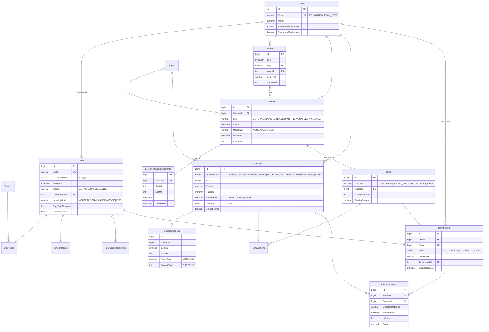

# EnglishHub – ERD (EnglishLearningDB)

30 bảng, chia 8 nhóm. Mọi bảng đều có `CreatedAt`, `UpdatedAt` (DATETIME2, UTC) – lược bớt trong sơ đồ cho gọn.

## 1. Định danh, nội dung & đánh giá

## 2. Lộ trình, kỹ năng, từ vựng, tiến độ, thông báo

```mermaid
erDiagram
    Users ||--o{ LearningPaths : ""
    Levels ||--o{ LearningPaths : ""
    TestAttempts |o--o{ LearningPaths : "sinh từ placement"
    LearningPaths ||--o{ LearningPathItems : ""
    Lessons ||--o{ LearningPathItems : ""

    Users ||--o{ SpeakingSubmissions : ""
    Users ||--o{ WritingSubmissions : ""
    Lessons |o--o{ SpeakingSubmissions : ""
    Lessons |o--o{ WritingSubmissions : ""

    Words ||--o{ VocabularySetWords : ""
    VocabularySets ||--o{ VocabularySetWords : ""
    Users |o--o{ VocabularySets : "bộ từ cá nhân"
    Users ||--o{ UserWords : "sổ từ"
    Words ||--o{ UserWords : ""
    UserWords ||--o{ FlashcardReviews : "lịch sử ôn"

    Users ||--o{ LessonProgresses : ""
    Lessons ||--o{ LessonProgresses : ""
    Users ||--o{ StudySessions : ""
    Users ||--o{ DailyActivities : "1 dòng/ngày"
    Users ||--o| UserStreaks : ""
    Users ||--o{ Notifications : ""

    LearningPaths {
        bigint Id PK
        bigint UserId FK "UNIQUE khi Status=ACTIVE"
        varchar GoalType
        int LevelId FK
        varchar Source "PLACEMENT|GOAL|MANUAL"
        varchar Status "ACTIVE|COMPLETED|ARCHIVED"
    }
    LearningPathItems {
        bigint Id PK
        bigint PathId FK
        bigint LessonId FK
        int SortOrder
        varchar Status "LOCKED|AVAILABLE|IN_PROGRESS|COMPLETED|SKIPPED"
        bit IsCustom
    }
    SpeakingSubmissions {
        bigint Id PK
        nvarchar ReferenceText
        nvarchar AudioUrl
        decimal PronunciationScore
        nvarchar DetailJson
        varchar Provider
    }
    WritingSubmissions {
        bigint Id PK
        nvarchar Content
        decimal Score
        nvarchar FeedbackJson
        varchar Provider
    }
    Words {
        bigint Id PK
        nvarchar Headword "UK(Headword, PartOfSpeech)"
        varchar PartOfSpeech
        nvarchar PhoneticUk
        nvarchar PhoneticUs
        nvarchar MeaningVi
        nvarchar Example
    }
    UserWords {
        bigint Id PK
        bigint UserId FK "UK(UserId, WordId)"
        bigint WordId FK
        varchar Status "NEW|LEARNING|REVIEW|MASTERED|SUSPENDED"
        decimal EaseFactor ">= 1.3"
        int IntervalDays
        int Repetitions
        datetime2 DueAt
    }
    FlashcardReviews {
        bigint Id PK
        bigint UserWordId FK
        tinyint Quality "0-5"
        decimal NewEaseFactor
        int NewIntervalDays
    }
    DailyActivities {
        bigint Id PK
        bigint UserId FK "UK(UserId, ActivityDate)"
        date ActivityDate
        int StudySeconds
        int WordsLearned
        int QuizzesTaken
        decimal TotalQuizScore
    }
    UserStreaks {
        bigint UserId PK
        int CurrentStreak
        int LongestStreak
        date LastActivityDate
    }
    Notifications {
        bigint Id PK
        bigint UserId FK
        varchar Type
        nvarchar Title
        bit IsRead
    }
```

## 3. Ghi chú thiết kế

| Vấn đề | Giải pháp |
|---|---|
| Một bảng câu hỏi cho nhiều dạng bài | `QuestionType` + cột phụ (`MatchText`, `CorrectOrder`, `AnswerKey` JSON) thay vì mỗi dạng một bảng – admin CRUD một chỗ, test tái dùng câu hỏi qua `TestQuestions`. |
| Placement Test và Quiz | Dùng chung `Tests`/`TestAttempts`, phân biệt bằng `TestType`; chỉ placement ghi `ResultLevelId`. |
| Chỉ 1 lộ trình đang chạy | Filtered unique index `UX_LearningPaths_User_Active ... WHERE Status = 'ACTIVE'`. |
| Truy vấn thẻ đến hạn ôn (SRS) | Filtered index `IX_UserWords_User_Due (UserId, DueAt) WHERE Status <> 'SUSPENDED'`. |
| Dashboard nhanh | Bảng tổng hợp `DailyActivities` (1 dòng/user/ngày) thay vì `SUM` trên log mỗi lần mở dashboard. |
| Lỗi "multiple cascade paths" của SQL Server | Chỉ cascade theo nhánh sở hữu chính (Users → dữ liệu cá nhân, Courses → Lessons → phụ đề). FK phụ (`FlashcardReviews.UserId`, `LearningPaths.PlacementAttemptId`, `UserWords.WordId`…) để NO ACTION. Đã kiểm tra: xóa một user xóa sạch dữ liệu liên quan. |
| Không xóa nhầm nội dung đang dùng | `LearningPathItems.LessonId`, `TestQuestions.QuestionId`, `AttemptAnswers.QuestionId` là NO ACTION → không thể xóa bài/câu hỏi đã nằm trong lộ trình hay bài làm; admin dùng `IsPublished`/`IsActive = 0` để ẩn. |
| Token bảo mật | `RefreshTokens`, `PasswordResetTokens` chỉ lưu SHA-256 hash. |
| Enum | `VARCHAR` + `CHECK` (map `@Enumerated(EnumType.STRING)` trong JPA). |
